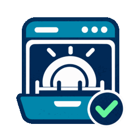

# Spülmaschine Verlauf



Home-Assistant-Integration zum lokalen Speichern von Programmenden und Ausräumbestätigungen.

Version **0.3.1** enthält die Verlaufsspeicherung, Dashboard-Karte und eine importierbare NFC-Automation ohne Bestätigungsdialog. Pushnachrichten zum Programmende bleiben in der bestehenden HA-Automation.

## Installation

Den Ordner `custom_components/spuelmaschine_verlauf` nach `/config/custom_components/` kopieren, Home Assistant neu starten und unter **Einstellungen → Geräte & Dienste → Integration hinzufügen → Spülmaschine Verlauf** einrichten.

Die vollständige Anleitung steht in [ANLEITUNG.md](ANLEITUNG.md). Eine Dashboard-Vorlage liegt in [dashboard.yaml](dashboard.yaml).

## Speicherung

Die Historie liegt lokal in `/config/spuelmaschine_verlauf.sqlite`. Sie wird nicht durch die normale Recorder-Aufbewahrung gelöscht. Die Datenbank gehört in die Sicherung der Home-Assistant-Konfiguration.

## Validierung

13 SQLite-Tests sind enthalten und erfolgreich. Ein Test in einer echten Home-Assistant-Instanz steht aus.

```sh
python3 -m unittest discover -s tests -v
```

## Neu in 0.1.1

Wird ein neuer Spülgang fertig, während der vorherige noch offen ist, erhält der vorherige als Ausräumer automatisch **Vera/Manuel**. Sein Status bleibt **nicht bestätigt**, weil niemand gescannt hat. Die tatsächliche Ausräumzeit ist unbekannt und bleibt leer. Bereits bestätigte Einträge werden nicht verändert. Der Dienst-Helfer bleibt unverändert. Keine rückwirkende Änderung bereits archivierter Spülgänge.

## Dashboard-Karte ab 0.2.0

Die neue Karte orientiert sich an Light Manager und Shutter Manager: HA-Akzentfarbe, kompakter Kopf mit Spülmaschinen-Symbol, Status, Einteilung sowie aufklappbarer Verlauf. Jeder Spülgang lässt sich für Fertigzeit, Bestätigungszeit, Person und Wartezeit aufklappen. Die Karte verwendet ausschließlich bereits lesbare HA-Entitäten und ruft keine Schreibaktionen auf.

Nach dem Update Home Assistant neu starten und die Dashboard-Seite bzw. Companion-App neu laden. Die JavaScript-Datei wird automatisch mit der Integration geladen; kein weiteres HACS-Frontend-Repository und kein manueller Ressourceneintrag nötig.

Die bisherige Markdown-Karte einmalig ersetzen:

```yaml
type: custom:spuelmaschine-verlauf-card
entity: sensor.spulmaschine_verlauf
duty_entity: input_select.spuelmaschine_dienst
title: Spülmaschine
history_open: false
max_entries: 30
```

Bei umbenanntem Verlaufssensor `entity` anpassen. `history_open: true` klappt den Verlauf initial auf. Access Control benötigt Leserechte auf beide konfigurierten Entitäten; weitere Rechte oder API-Freigaben kommen durch diese Karte nicht hinzu. Das alte Markdown-YAML bleibt nutzbar, wird aber nicht automatisch umgebaut.

Frontend-Prüfung mit Node.js und `linkedom`: `node tests/test_card.cjs`. Die DOM-Prüfungen decken Zustände, Zeitformatierung, aufklappbare Details und sicheres Einfügen von Text ab. Ein visueller Test in deiner HA-Instanz steht aus.

## Darstellung ab 0.2.1

Die Karte hat keine Versionszeile und keinen Status oben rechts. Der aufklappbare Verlauf zeigt ausschließlich Ausräumer und Ausräumzeit. Vera und Manuel erscheinen unter der gemeinsamen Bezeichnung **Vera & Manuel**. Automatisch zugeordnete Einträge ohne Ausräumzeit zeigen **Zeitpunkt unbekannt**. Offene Spülgänge stehen nur im Hauptbereich. Die vorhandene YAML-Konfiguration bleibt gültig. Die Begrenzung auf die letzten 30 Spülgänge des Verlaufssensors bleibt bestehen.

## NFC ohne Rückfrage ab 0.2.2

**Das HACS-Update allein ersetzt keine bestehende Automation.**

1. HACS-Update installieren und Home Assistant neu starten.
2. Unter Einstellungen → Automationen & Szenen → Blaupausen die URL importieren:
   `https://github.com/v9h45n47mh-lab/spuelmaschine-verlauf/blob/main/blueprints/automation/spuelmaschine_nfc.yaml`
3. Aus der Blaupause eine Automation anlegen. Tag-ID, Verlaufssensor, Diensteinteilung und die vier unterschiedlichen Companion-App-Geräte auswählen.
4. Bisherige Automation **Spülmaschine – NFC Ausräumen bestätigen** deaktivieren und neue Automation aktivieren. Keine weitere Automation darf für denselben Scan den Dienst wechseln.

Der Scan speichert sofort Ausräumer und Zeitpunkt. Vera und Manuel können jeden offenen Spülgang abschließen; dabei bleibt der Dienst unverändert. Maximilian und Paul dürfen nur scannen, wenn sowohl die aktuelle Diensteinteilung als auch der offene Spülgang zu ihnen passen. Danach wechselt der Dienst zum anderen Kind. Unbekannte Geräte und Scans ohne offenen Spülgang ändern nichts. Wiederholte Scans erzeugen keinen zweiten Eintrag oder Dienstwechsel.

Die Prüfung erfolgt anhand der registrierten Companion-App-Geräte-ID. Dieselbe Geräte-ID darf nicht mehreren Personen zugeordnet sein. Ein physisches Lesen des NFC-Tags durch andere Personen lässt sich nicht verhindern; ihre Scans werden verworfen. Bestehende Access-Control-Freigaben für NFC bleiben erforderlich.

Die Datenbank und das Dashboard-YAML bleiben unverändert. Die Vorlage wird nicht automatisch aktiviert. Ein Test in einer laufenden HA-Instanz steht aus.

Prüfung ab 0.2.2: 20 Tests (SQLite und NFC-Vorlagen mit PyYAML/Jinja2) sowie Frontend-DOM-Prüfungen erfolgreich. Zum Testen zusätzlich `python3 -m pip install PyYAML Jinja2` installieren; die Integration selbst braucht diese zusätzlichen Pakete nicht.

## Monatsverlauf und Statistik ab 0.3.0

Der Verlauf ist nach Monat und Jahr gruppiert. Die Monatsgruppen sind einzeln aufklappbar; ihr Zustand bleibt bei Aktualisierungen und beim Wechsel zwischen Hauptseite und Einstellungen erhalten. Die Elternanzeige lautet überall **Vera / Manuel**. Bei bekanntem Ausräumzeitpunkt gilt dessen Monat, sonst der Monat des Programmendes. Der Hauptverlauf zeigt weiterhin die Einträge aus den letzten 30 Spülgängen (bzw. `max_entries`).

Das Zahnrad öffnet die Einstellungen mit Versionsnummer und Statistik. Je Monat werden Gesamtanzahl und Anzahl für Maximilian, Paul sowie Vera / Manuel angezeigt. Die Statistik zählt **alle** gespeicherten Ausräumvorgänge, unabhängig von der Begrenzung des Verlaufs. Offene Spülgänge zählen nicht. Automatische Elternzuordnungen ohne Scan werden mitgezählt und mit ihrer Anzahl ausdrücklich gekennzeichnet. Die Monatsstatistik wird in der HA-Zeitzone berechnet.

Einstellungen werden nur den HA-Konten Vera und Manuel angezeigt. Ohne zusätzliche Konfiguration erkennt die Karte den ersten Namensteil des angemeldeten HA-Benutzers (Vera oder Manuel, Groß-/Kleinschreibung egal, z. B. auch Manuel Wagner). Adminstatus allein genügt nicht. Bei anderen Kontonamen oder für eine feste Kontozuordnung die beiden tatsächlichen **HA-Benutzer-IDs** in der Karte ergänzen (keine iPhone-Geräte-IDs):

```yaml
settings_users:
  - HIER_VERAS_HA_BENUTZER_ID
  - HIER_MANUELS_HA_BENUTZER_ID
```

Eine ausdrücklich gesetzte Liste ersetzt die Namenserkennung; `settings_users: []` blendet Einstellungen für alle aus. Diese Einstellung steuert die Sichtbarkeit der Kartenansicht. Die Statistik liegt als Attribut `statistik` auf demselben Verlaufssensor und unterliegt dessen bestehenden HA-/Access-Control-Leserechten.

Update über Marketplace/HACS installieren, Home Assistant neu starten und Dashboard/Companion-App neu laden. Das bestehende Dashboard-YAML bleibt gültig. NFC-Blaupause und Benachrichtigungsautomationen müssen für dieses Update nicht verändert werden.

Validierung 0.3.0: 23 Tests einschließlich Monatsgrenzen in Europe/Berlin, Jahreswechsel, vollständiger Statistik, zusammengefassten Eltern und gekennzeichneten automatischen Zuordnungen. DOM-Prüfungen für Monatssortierung, Klappzustände, Einstellungsrechte und Versionsanzeige. Ein visueller Live-Test in HA steht aus.

## Gesamtstatistik und Logo ab 0.3.1

Die Statistik in den Einstellungen zeigt **eine Gesamtübersicht über den gesamten gespeicherten Zeitraum**, ohne Monatsunterteilung: Maximilian, Paul, Vera / Manuel und Gesamtanzahl. Automatische Elternzuordnungen ohne Scan bleiben mit ihrer Anzahl gekennzeichnet. Die Monatsgruppierung gilt weiterhin nur für den Verlauf. Einstellungen und Versionsnummer bleiben ausschließlich für Vera/Manuel sichtbar.

Die Integration enthält jetzt ein eigenes transparentes Spülmaschinen-Logo mit Erledigt-Häkchen unter `custom_components/spuelmaschine_verlauf/brand/icon.png` (256 × 256) und `icon@2x.png` (512 × 512). Home Assistant und der aktuelle Marketplace unterstützen diese lokalen Markenbilder. Anzeige nach dem Update und Neustart prüfen; zwischengespeicherte Marketplace-Bilder können verzögert aktualisiert werden. Für ältere HACS-Versionen kann die Darstellung abweichen.

Die Bereitstellung folgt der [HA-Dokumentation zu Markenbildern](https://contributors.home-assistant.io/core/integrations/brands/) und der [Marketplace-Anleitung](https://contributors.home-assistant.io/marketplace/guides/integrations/). Das Bild wurde mit dem integrierten Bildgenerator erstellt und für die beiden vorgegebenen Auflösungen exportiert.

Update über Marketplace installieren, HA neu starten und Dashboard/Companion-App neu laden. Dashboard-YAML, Datenbank und NFC-Automation bleiben gültig. 23 Logiktests und Frontend-DOM-Prüfungen erfolgreich, einschließlich Gesamtsummen über mehrere Monate. Live-Anzeige im Marketplace und HA bleibt vor Ort zu prüfen.
